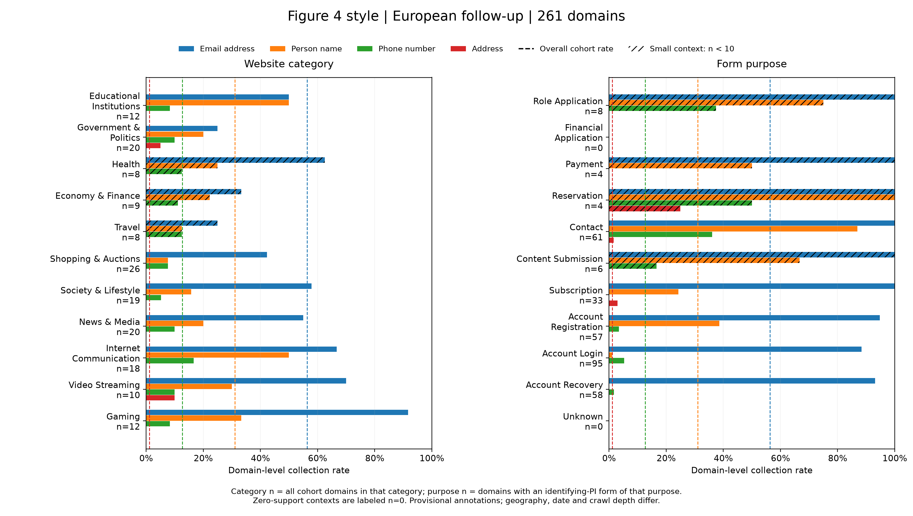
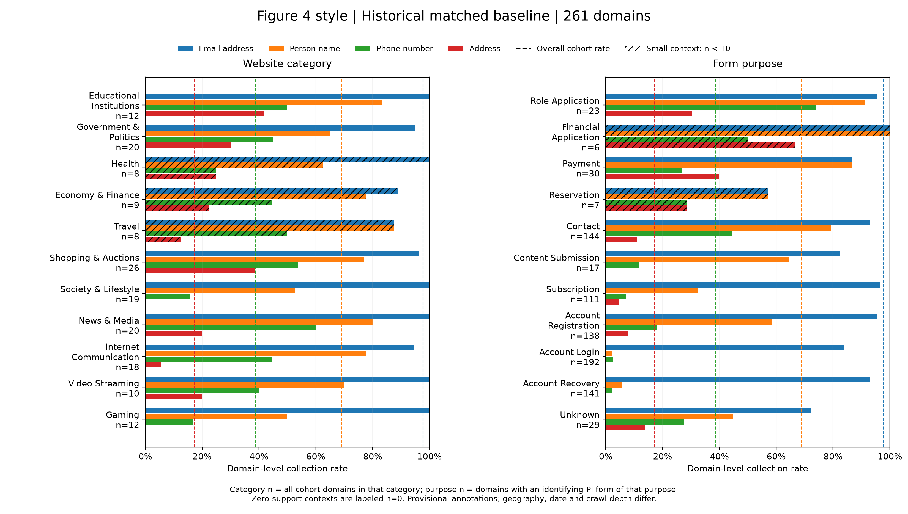
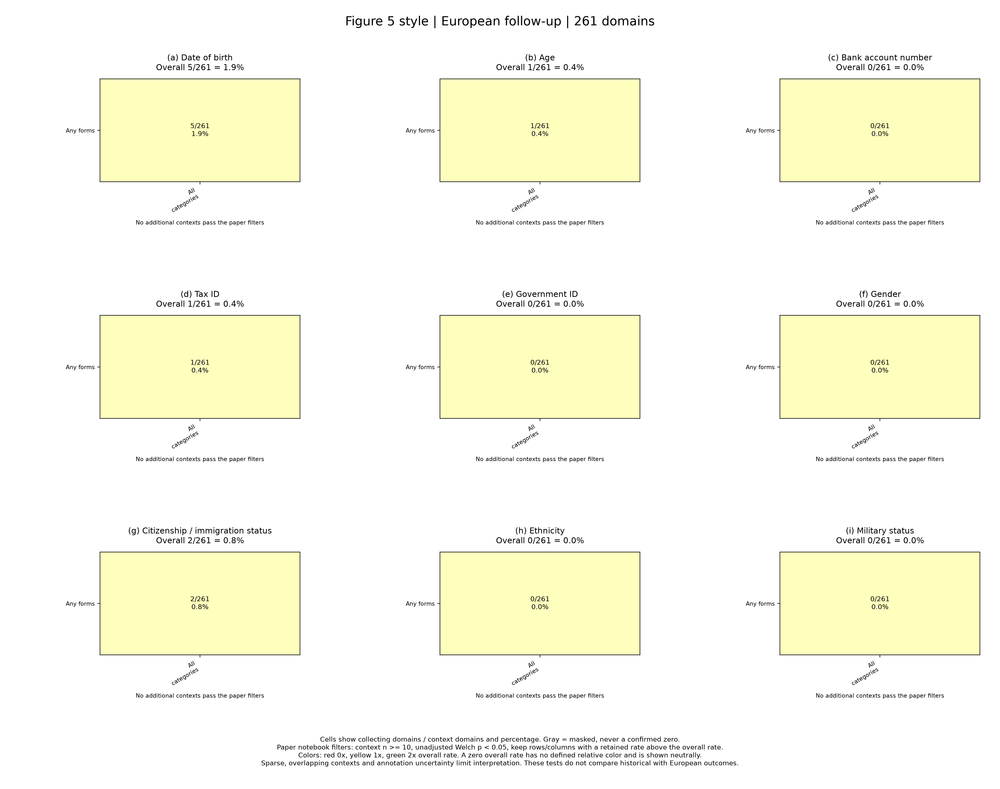
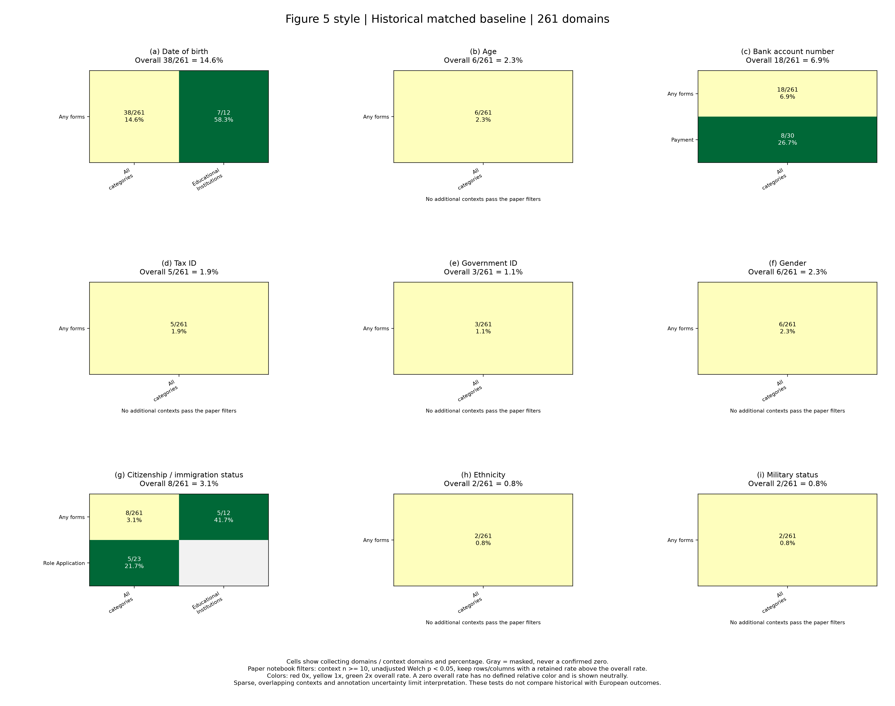
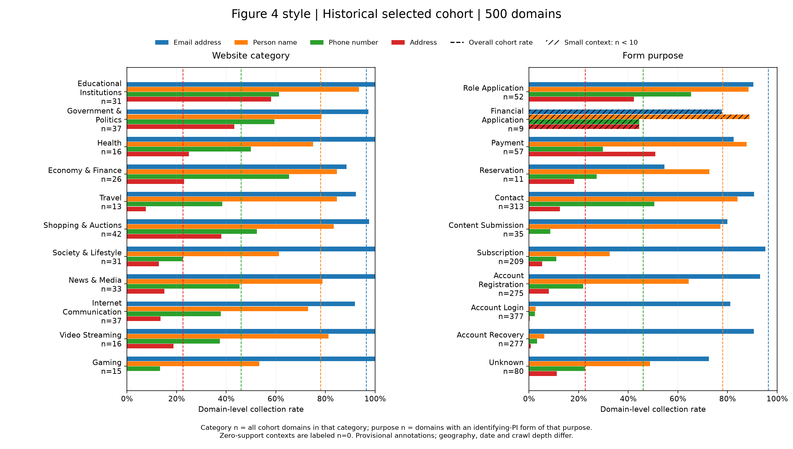
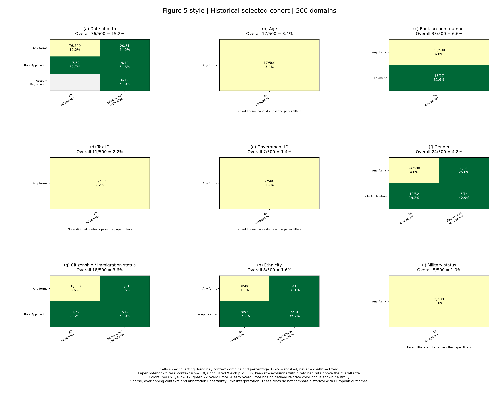
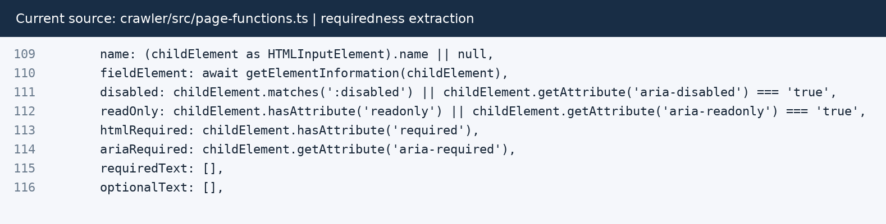

# Web forms and observed privacy norms: a bounded European follow-up

Public aggregate outputs are in `results/`. Raw captures, prediction records, historical databases and private review packets referenced below are local evidence and are excluded from the repository.

DD2496 Group 06: Mattia, Linnea, Elissa and Sarah. Evidence snapshot: 9 October 2026, Europe/Stockholm.

## Abstract

We studied the artifact for *Understanding Privacy Norms through Web Forms* and built a bounded follow-up using its crawler and historical annotations. We sampled 500 historically observed domains, crawled them with a European browser profile and user-declared Swedish network egress, and annotated new captures with TypeSafe AI Jev. Of 500 attempted domains, 405 completed and 261 met the final comparison rules. Historical and new observations use exactly those same 261 domains. We reused historical annotations rather than retraining the authors' classifiers or rerunning their historical crawl.

Historical versus new collection counts were 255 versus 147 for email addresses, 180 versus 81 for names, 101 versus 33 for phone numbers and 45 versus 3 for addresses. We adapted the paper's contact-information graphs and rare-information heatmaps and measured declared requiredness separately. A limited audit of annotations before selective reannotation found exact agreement on 17/20 random form purposes and 16/20 random field-group label sets. It has one reviewer; fresh human validation of the final hybrid method remains unavailable. Cumulative API cost is $0.658587720 measured plus $0.005376 reserved. Differences combine dates, location, browser versions, crawl depth, annotation methods and uncertainty exclusions. They do not isolate a regional effect or prove field removal. Sources are [final counts](../results/summary.json), [matched rates](../results/rates.csv), [requiredness](../results/requiredness.csv) and audit results (`04-validate/data/human-examination/audit-results.md`, local evidence).

## Motivation and research questions

Cui, Trimananda and Markopoulou's PoPETs 2025 paper asks what information websites request through web forms and how those requests vary with website category and form purpose. It treats common contextual patterns as evidence about privacy norms. Personal information, abbreviated PI, means information requested about a person. A form purpose describes the intended task, such as account login, subscription or payment. A context combines purpose and website category.

The paper's measurement complements surveys of privacy expectations and measurements of background tracking. Surveys examine people's judgments; tracking studies examine automatic collection. Forms expose requests that users encounter directly, including information that background tracking may not reveal. The paper uses contextual integrity as its conceptual basis. The frequency of a request supplies an empirical baseline, but frequency alone does not establish that collection is necessary, acceptable or lawful. The authors also compare forms with privacy-policy disclosures. Our follow-up does not include that analysis. See the [paper](https://doi.org/10.56553/popets-2025-0002), Sections 1, 2, 5, 6 and 7.

Our questions are:

1. Can we run the released crawler at smaller depth on a current Apple silicon environment, preserve its useful extraction semantics and generate an auditable dataset?
2. On domains with usable evidence in both datasets, what PI collection patterns do the saved historical annotations and new captures show under the same domain-level analysis rules?
3. What explicit requiredness signals appear in the new captures, and what does a small human audit reveal about annotation agreement and uncertainty?

These questions define a bounded artifact study. They do not test a causal hypothesis about European regulation. The sites are globally selected historical domains accessed from Europe, rather than a sample of European websites.

## Assignment scope and artifact contributions

The supplied assignment requires artifact exploration, a short screen-recorded demonstration and written documentation as a PDF. Its A criterion requires at least two exploration options, running code, a thorough explanation and walkthrough, and work at a level that could be shared with the authors through substantial effort, clear reasoning and new insight. This report presents evidence for those criteria, rather than claiming a grade.

| Exploration option | Work completed | Result and interpretation |
| --- | --- | --- |
| Use a different dataset | Collected new forms from a fixed historical-domain cohort using a European-access browser profile. | 7,953 exported forms; historical/new analysis on 261 identical eligible domains. Location is not isolated from time or method. |
| Vary parameters | Ran the released crawler with a twenty-job cap rather than the historical hundred-job cap. | A bounded 500-domain revisit with measured coverage, runtime and storage. This is not a controlled twenty-versus-hundred depth experiment. |
| Make changes in the code | Added compatibility, control visibility, declared requiredness, bounded orchestration and direct sanitized annotation. | A working five-step workflow, saved source patch, explicit uncertainty and auditable result lineage. |
| Ask a different question | Measured whether newly captured controls explicitly declare themselves required or optional. | Requiredness over 11,005 eligible visible controls, with 62.1% unspecified. This measures declarations rather than enforcement. |
| Generate different graphs from the artifact | Adapted contact and rare-PI plot styles to matched historical/new data and separate selected-cohort context. | Final figures preserve denominators and support masks. Sparse heatmaps are bounded observations, not population-wide absence. |

These activities overlap; they are not five independent experiments. The substantive contribution is the combination of a bounded new measurement, an implemented declaration-level extension, and a documented analysis of uncertainty and comparability. We reused historical labels, rather than reproducing the entire published annotation system.

The agreed scope excludes privacy-policy processing, new website categorization, automated later-form-step progression, a contemporary US control crawl and historical classifier training.

## Repository and reproducibility package

The project repository is [mperf/webform-privacy-norms](https://github.com/mperf/webform-privacy-norms). The five entry scripts, READMEs, saved patch, report and selected aggregate outputs are at its root. The authors' [upstream repository](https://github.com/UCI-Networking-Group/webform) is a separate dependency. At this snapshot, the public package is prepared locally; the initial commit and remote publication remain pending. Raw captures, historical databases, prediction records and private review packets are not included.

The [code guide](code-structure.md) documents the five entry scripts, file responsibilities and data flow. The [execution evidence](script-execution-log.md) distinguishes captured output from saved summaries. Raw captures, credentials and private review answers stay local. A reproducibility package can include the saved aggregate results and selected log excerpts, subject to the repository's dataset-sharing constraints.

## Original paper and artifact reproduction

The paper is *Understanding Privacy Norms through Web Forms*, by Hao Cui, Rahmadi Trimananda and Athina Markopoulou, Proceedings on Privacy Enhancing Technologies 2025, issue 1, pages 5–22, DOI [10.56553/popets-2025-0002](https://doi.org/10.56553/popets-2025-0002). Its California-based crawl ran from December 2023 through January 2024. The paper reports 938,324 raw HTML forms from 11,500 websites and 292,655 forms after cleaning. Those are the authors' measurements, not ours. Its form classifier uses MarkupLM with LLM-assisted training and active learning. Its PI classifier uses SetFit. See paper Sections 3 and 4.

We pinned the [released source](https://github.com/UCI-Networking-Group/webform) at `a4f391d604e5cd557b881145b2a1cfd072e542d0`. The artifact evaluation appendix (`upstream/ARTIFACT-EVALUATION.md`, local evidence) supplies smaller-scale exercises for crawling, annotation, form analysis and policy analysis. Our bounded protocol differs from those exercises. We did not claim to complete every artifact-evaluation experiment or reproduce the published dataset exactly.

| Artifact component | Work completed here |
| --- | --- |
| Historical website metadata and annotations | Reused the released `domain.db` and `webform-data.db` as read-only references. |
| Crawler | Executed the original TypeScript crawler with documented compatibility, visibility, profile and requiredness changes at a 20-job cap. |
| Historical form and PI classification | Reused saved predictions. Did not download historical classifier weights, retrain classifiers or reannotate historical forms. |
| New annotation | Implemented direct Jev annotation of sanitized new evidence with the source taxonomies and explicit review states. |
| Form analysis | Implemented domain-level PI aggregation and paper-style adaptations of Figures 4 and 5 in Python. |
| Privacy-policy analysis | Outside scope; Figure 6 was not reproduced. |

The only retained local model is the crawler's original CPU MiniLM-L6-v2 navigation scorer through ONNX. It scores navigation tasks; it does not classify form purposes or PI. We installed no CUDA, Torch or full historical classifier environment. The precise distinction between historical annotation reuse and crawler/analysis reproduction is central to interpreting the results. Evidence is in the [preparation README](../01-prepare/README.md), [crawler README](../02-crawl/README.md), [annotation README](../03-annotate/README.md), [analysis README](../05-analyze/README.md) and [saved crawler patch](../02-crawl/data/crawler.patch).

## Implementation and environment

The experiment retains one README and one Python entry script per step. Preparation inspects the released databases and freezes the cohort. Crawling invokes the upstream TypeScript program and normalizes its captures. Annotation makes bounded, sequential requests. Validation exports blinded questions and evaluates supplied answers. Analysis writes separate results and figures. Historical references remain read-only, raw attempts remain local, and annotation records and the budget ledger retain their append-only history.

The host is an Apple M4 Mac running macOS 27. The original Playwright 1.41.2 and Chromium 121 could not launch on that host. We pinned Playwright 1.64.0 with Chromium 156.0.8078.4 and retained the original extension behavior through compatible headless persistent contexts. The cookie extension was version 1.1.1 and Privacy Badger was version 2026.9.15. Python uses a small environment for parsing, decompression and plotting. Matplotlib 3.11.2 and SciPy 1.18.1 support the completed figures. These changes affect comparison with the historical experiment. Sources are setup evidence (`01-prepare/data/setup.json`, local evidence), the [preparation README](../01-prepare/README.md) and the [crawl README](../02-crawl/README.md).

The main crawler changes correct individual-control visibility, add configurable locale/timezone/coordinates, retain separate requiredness signals and disable routine screenshots. The Python wrapper adds four-worker orchestration, per-site timeouts, resumable attempts, storage monitoring and capture normalization. The normalizer excludes invisible and disabled buttons. See the [code structure](code-structure.md) and [crawler patch](../02-crawl/data/crawler.patch) for implementation details.

## Installation and running the artifact

The local runtime was prepared on Apple M4/macOS 27 with Node 22.23.3. The authors' original browser could not launch, so the saved patch pins Playwright 1.64.0 and Chromium 156.0.8078.4. The original CPU navigation scorer remains. The historical classifier environment is unnecessary because we reuse released annotations. Python dependencies are pinned for parsing, bounded archive expansion and plotting.

For a clean checkout, the [preparation README](../01-prepare/README.md#restore-the-pinned-checkout-on-another-machine) gives the exact source checkout and patch sequence. From `webform-privacy-norms`, the entry points are:

```sh
python3 01-prepare/run.py setup --warm-navigation
.venv/bin/python 01-prepare/run.py inspect
.venv/bin/python 01-prepare/run.py select
```

Setup installs dependencies, applies the saved patch when needed and compiles the crawler. Inspect/select require the released databases already obtained and expanded locally. The recorded 7.381-second setup duration is warm verification, not initial installation time. The [preparation evidence](script-execution-log.md#01-prepare) records archive sizes, integrity checks and the limits of saved stdout.

The full crawl and annotation have already run. Their commands can contact sites, spend money or replace outputs, so a demonstration should inspect saved results rather than rerun the experiment. The [video guide](video-walkthrough-guide.md) contains commands and expected results, and the [code guide](code-structure.md#inspecting-or-regenerating-final-outputs) gives the explicit final-analysis branch. The default analysis branch selects original inputs, while the final comparison uses the separate versioned folder.

## Design decisions and reasoning

| Decision | Reasoning | Consequence |
| --- | --- | --- |
| Fixed historical cohort and unchanged categories | Compare domains with historical evidence and avoid replacing failures with easier sites. | Sampling and attrition are auditable; historical categories may be outdated. |
| Smaller crawl budget with recorded partial outcomes | Make a working revisit feasible under the time/storage limits. | Captured states are shallower; reduced coverage can contribute to lower observed collection. |
| Individual control visibility and separate requiredness signals | A visible form can contain hidden controls, and absence of an HTML required attribute does not prove optionality. | Preserve HTML, ARIA and text evidence separately, including unspecified/conflicting signals. |
| Sanitized direct annotation with explicit abstention | Label new captures without training the authors' classifiers while limiting transmitted evidence. | Taxonomies stay comparable at the label level, but annotation methods and coding definitions differ. |
| Matched domain-level aggregation | Avoid treating repeated forms as independent websites or comparing two different domain populations. | Each domain contributes once per information type; uncertain domains remain excluded. |
| Frozen selected replacements and record lineage | Added context should not silently rewrite unrelated predictions or reset budget history. | Each annotation joins against its own frozen evidence; increased eligibility does not establish improved accuracy. |

The implementation deliberately preserves uncertainty. A confidently nonidentifying form can support a bounded observed zero without resolving its purpose, while unresolved PI blocks comparison. Treating every Unknown purpose as a failure or every missing PI label as absence would answer a different question. Relevant behavior is in `build_database` and `hybrid_predictions` in the analysis entry script.

## Cohort selection

An eligible historical domain needs a joined historical form/field annotation with a recognized purpose and a nonempty list of source PI labels, plus rank, valid historical category objects and an HTTP starting URL. Selection does not yet require identifying PI. The preparation script inspects actual SQLite schemas, sorts eligible domains and uses `random.Random(42).sample` to select 500 from 10,143 eligible domains. It preserves historical ranks, categories and starting URLs and does not replace later failures. Empty historical category lists retain Unknown.

The fixed cohort's SHA-256 checksum is `9a454091daead43902d188da386a2658b0681afc2194dd39ae2224d998bff4dc`. The selection manifest (`01-prepare/data/manifest.json`, local evidence) records selection SQL, rules, seed, database checksums, category mapping and cohort checksum. The [preparation script](../01-prepare/run.py) implements the selection. Categories remain historical metadata and may no longer describe current sites. This sample is neither Europe's website population nor a fresh Tranco sample.

## Crawling and evidence normalization

The browser uses `en-US`, `Europe/Stockholm`, latitude 59.3293 and longitude 18.0686. Swedish egress is user-declared and was not independently measured. Timezone and coordinates cannot establish network location. The wrapper runs four site workers, allows 20 jobs per site, sets a 600-second site timeout and passes `--minJobTime 0`. The upstream defaults were 100 jobs and at least six seconds per job. Page-readiness waits remain. A job is a navigation task and does not necessarily represent a unique page. See the run manifest (`02-crawl/data/run-manifest.json`, local evidence) and [crawl implementation](../02-crawl/run.py).

The crawler explores captured states without adding form filling, submission or later-step automation. The wrapper preserves each attempt separately. The normalized export uses the status-selected latest attempt for each domain, including partial evidence. It retains older raw attempts locally. The 10 GiB crawl-output ceiling is a monitored stop condition with worker headroom, not an atomic filesystem quota. No storage stop occurred.

| Crawl stage or output | Count |
| --- | ---: |
| Selected and attempted domains | 500 |
| Complete domains | 405 |
| Partial timeouts | 55 |
| Failed domains | 6 |
| Unreached domains | 34 |
| Reached domains | 466 |
| Form-bearing domains across exports | 407 |
| Saved pages | 7,344 |
| Normalized forms | 7,953 |

The outcome rows sum to 500. Form-bearing domains include partial captures and are not the matched-comparison denominator. The full-run summary (`02-crawl/data/full-summary.json`, local evidence) records 23,933.245 seconds, approximately 6.65 hours, and 2,728,191,749 bytes of crawl-step output, approximately 2.54 GiB. That duration belongs to the saved resumed full-run controller summary. It is not total project time, first installation time or the sum of every pilot and restart. The export summary (`02-crawl/data/export-summary.json`, local evidence) records no malformed exported records.

Normalized controls retain labels, HTML names, types, visibility, disabled/read-only states and descriptive attributes. Controls with the same nonempty HTML name share a field group, as in the authors' PI feature extraction; unnamed controls remain separate groups. Group identity and individual-control requiredness are distinct. Within a capture, domain, job hash and form filename join records. Those keys do not identify the same form across years. See [normalization rules](../02-crawl/README.md).

## Annotation and handling uncertainty

Jev 1.13.0 assigns a form purpose from the source's ten purposes plus Unknown, and answers nineteen PI-label questions for each eligible field group. Multiple PI labels can apply. The paper-rate export retains sixteen types by omitting Password, Fingerprints and BusinessInfo from that export only. Search/filter tasks can remain Unknown because the purpose taxonomy does not cover them, and the PI taxonomy has no payment-card class.

Hidden, invisible, disabled, read-only and button controls do not enter eligible annotation groups. Requests use sanitized labels, titles, visible button text and whitelisted descriptive attributes. Relevant saved-form headings and explanations supplement selected contexts. These descriptions exclude control values, URLs, raw HTML and capture identifiers. Oversized contexts remain review without transmission.

The final protocol combines carried-forward annotations with selective reannotation of 1,018 form/group records. Untouched records retain their original evidence and configuration; replacements use frozen enriched evidence and provisional clarifications of overlapping label meanings. The analysis verifies each record against its own saved configuration. Context and coding definitions changed together, and historical labels remain unchanged. See the frozen selection (`03-annotate/data/methodology-v3/selection.json`, local evidence) and [lineage summary](../results/summary.json). Detailed implementation belongs in the [code-structure guide](code-structure.md).

The PI threshold is 0.5, with the inclusive 0.4 to 0.6 interval requiring review. Purpose confidence below 0.6, or Unknown, also requires review. These gates were retained during selective reannotation. Accepted empty PI lists can establish observed absence; review and failures cannot. Cache keys include sanitized evidence, question definitions, model, prompt version and thresholds.

All 43,092 current identities, comprising 7,953 forms and 35,139 groups, have annotations or explicit review records. The final analysis finds 3,316 fully annotated forms and 7,478 comparison-resolved forms. Those measures are different because a confidently nonidentifying form can support comparison without resolved purpose. Of the 1,018 selectively reassessed records, 521 are accepted and 497 remain review. These are processing and coverage counts, not accuracy measurements.

Cumulative API cost is $0.658587720 measured plus $0.005376 reserved, totaling $0.663963720. Two earlier calls retain reservations because their billing outcome is unknown. The shared working cap is $4.90 under the $5 ceiling, leaving $4.236036280 of working allowance. Selective reannotation measured 705 requests across two batches and added $0.049981302. Reused answers supplied 312 identity records; one oversized record stayed unpaid review. No new failures or reservations occurred. Batch durations and detailed accounting are in the [execution evidence](script-execution-log.md#03-annotate).

## Requiredness extraction

Requiredness means an explicit declaration in the saved capture. HTML `required` presence, including `required=""`, is one signal. ARIA-required or explicit required/mandatory text supplies another. Explicit optional/not-required text or ARIA-required false can supply an optional signal. A star counts only when saved evidence defines its meaning. Missing signals remain unspecified. Required and optional evidence together produce a conflict.

These signals can overlap. The text rules recognize English expressions, while an English browser profile does not guarantee English site content. A declaration does not establish browser or server enforcement. Historical annotations do not expose corresponding requiredness, so this measurement describes the new crawl only.

| Signal | Eligible visible user controls | Percentage of 11,005 |
| --- | ---: | ---: |
| HTML-declared required | 3,044 | 27.7% |
| ARIA/text-declared required | 1,556 | 14.1% |
| Explicit optional signal | 164 | 1.5% |
| Unspecified | 6,833 | 62.1% |
| Conflicting signals | 2 | 0.018% |

The denominator includes all exported attempts selected for analysis, including partial sites. It is not limited to 261 comparison domains. The signal percentages must not be summed as disjoint categories. The [requiredness CSV](../results/requiredness.csv) separately reports 27,551 technical controls. Disabled, read-only and button controls do not enter the eligible-visible-user denominator. Most eligible controls lack an explicit declaration; that does not mean they are optional.

## Limited human audit

The completed packet contains 20 random form questions and 20 random eligible field-group questions, plus five targeted form and five targeted group questions selected from review states. Questions match current capture signatures, exclude earlier development components and hide Jev answers. Form and group questions were sampled independently. The targeted questions diagnose uncertainty and must not be pooled into an accuracy estimate.

Mattia explicitly confirmed all 50 answers. We describe these labels as human-confirmed. They are not independently authored or a multi-reviewer gold standard. The settings declaration was KEEP_CURRENT. No elapsed human-review time is claimed. The audit results (`04-validate/data/human-examination/audit-results.md`, local evidence) document provenance, sample scope and disagreements.

| Random audit measurement | Result |
| --- | ---: |
| Exact form-purpose agreement | 17/20, 85% |
| Accepted form-prediction coverage | 16/20, 80% |
| Exact field-group label-set agreement | 16/20, 80% |
| Accepted group-prediction coverage | 18/20, 90% |

Exact agreement includes effective Unknown/review states; it is not accuracy conditional on a resolved prediction. The three form disagreements are human Unknown versus confident model purposes. Two group disagreements are abstentions. The other two are confident PI differences: an extra user-identifier label on an email/phone alternative, and a storage-region preference treated as personal location. The saved random metrics (`04-validate/data/human-examination/random-results/metrics.json`, local evidence) retain class support and unsupported null scores.

All five targeted purposes are Unknown and agree with model abstention. Four targeted group references are resolvable and differ from abstentions; one is Unknown and agrees. See targeted metrics (`04-validate/data/human-examination/targeted-results/metrics.json`, local evidence). Across both samples, requiredness agrees on 27/27 controls: seven required and 20 unspecified. There are no optional or conflict examples. The audit checks saved declarations, not extraction fidelity against a live rendered page or enforcement after submission.

The original approximately 100-form/300-group validation target remains incomplete. The preserved 211-row pilot CSV has 152 changed signatures and five missing forms, so it is not a current-run evaluation sample. Rare PI classes lack support in the completed small audit. Its agreement percentages are useful diagnostic evidence, not claims of dataset-wide accuracy.


The audit evaluates the annotations available before selective reannotation. It does not validate the final hybrid protocol. A separate blinded packet contains 12 forms and 16 groups from 12 reserved domains; its human-label fields remain blank. The final method therefore has no fresh human accuracy estimate.

## Analysis and denominators

Analysis unions accepted PI labels across qualifying forms on each domain. A domain with one email form and a domain with twenty email forms each contribute one email observation. The upstream identifying-PI rule filters forms before aggregation. The historical and new sides use the identical set of 261 comparison-eligible complete domains, recorded in compared-domains.json (`05-analyze/data/methodology-v3/final/compared-domains.json`, local evidence).

A complete domain qualifies only when all eligible group PI evidence is resolved and every form with identifying PI also has a resolved purpose. Confidently nonidentifying forms can qualify with unresolved purpose. The 58 complete zero-form domains count as observed zeros. Partial, failed and unreached outcomes do not enter the comparison. Of 405 complete domains, 261 qualify and 144 remain excluded through uncertainty. The final evidence has 358 blocking forms, 327 unresolved eligible groups and 125 currently required purpose blockers on complete domains. These units overlap and must not be added.

All-purpose rates divide collecting domains by the stated cohort or category population. Purpose-specific rates condition on domains with an identifying-PI form of that purpose. Categories and purposes overlap. Requiredness uses a separate control-level population across exported outcomes. None of these rates measures the fraction of all websites that collect a type, or matches individual forms across years. Sources are [final counts](../results/summary.json) and the [analysis README](../05-analyze/README.md).

## Results on the matched 261 domains

Both columns use exactly the same domains. Historical observations come from the authors' saved annotations; new observations use the final hybrid protocol.

| PI type | Historical | New crawl |
| --- | ---: | ---: |
| EmailAddress | 255/261, 97.7% | 147/261, 56.3% |
| PersonName | 180/261, 69.0% | 81/261, 31.0% |
| PhoneNumber | 101/261, 38.7% | 33/261, 12.6% |
| Address | 45/261, 17.2% | 3/261, 1.1% |

The [saved matched rates](../results/rates.csv) show lower observed contact-information collection in the new captures under this protocol. They do not prove removal of individual fields or isolate a location effect. Dates, browser versions, crawl depth and annotation methods differ.

New rare-PI observations are DateOfBirth 5/261, AgeOrAgeGroup 1/261, TaxId 1/261 and CitizenshipOrImmigrationStatus 2/261. BankAccountNumber, GovernmentId, Gender, Ethnicity and MilitaryStatus have observed-zero overall counts under eligibility rules. Rare-class accuracy is not human-validated, and these bounded zeros do not establish population-wide absence.

## Paper-style figures and interpretation

The figures adapt the paper's Figures 4 and 5. Report figure numbers below are separate from the paper's numbering. Privacy-policy Figure 6 is outside scope. Contact-information bars show four types across selected categories and purposes. Dashed lines show overall rates, printed labels give context denominators, and hatching marks support below ten. A context with n=0 has no available denominator.

Rare-PI heatmaps use nine types and the upstream notebook's display filters: support of at least ten context domains, an unadjusted Bernoulli Welch p-value below 0.05, and row/column retention requiring a retained rate above the dataset's overall rate. Overall cells remain visible. Undefined tests remain masked. Gray cells are masked, not confirmed zeros. These descriptive tests compare contexts within each dataset; they do not test paired historical-versus-new differences. Contexts overlap and no multiple-testing correction was added. The [cell CSV](../results/figures/figure-5-cells.csv) and manifest (`05-analyze/data/methodology-v3/final/figures/manifest.json`, local evidence) preserve support and display decisions.

### Matched comparison figures



Figure 1. New observations on 261 matched domains. Overall denominator is 261. Category denominators count those domains in each category; purpose denominators count those with an identifying-PI form of that purpose. Exact denominators appear on the graph. Compare with Figure 2 on the identical domain set.



Figure 2. Historical annotations on exactly the same 261 domains. Overall denominator is 261. Purpose-specific denominators can differ from Figure 1 because the observed qualifying purposes differ. Hatching marks support below ten.



Figure 3. New rare-PI observations on 261 domains. Overall counts are birth date 5/261, age 1/261, tax ID 1/261 and citizenship/immigration status 2/261; the other five types have observed-zero counts. No new context cell passes all display filters. Gray cells remain masked.



Figure 4. Historical rare-PI observations on the identical 261-domain set. Four context cells survive the descriptive filters. Their within-dataset p-values do not establish a significant historical-versus-new change.

### Historical selected-cohort context



Figure 5. Historical contact-information rates on all 500 selected domains. Overall denominator is 500, with conditional category/purpose denominators printed. This is separate cohort context and must not be compared directly with the new 261-domain rates.



Figure 6. Historical rare-PI context on the selected 500 domains. Fourteen context cells survive the filters. Gray cells remain masked.

The [six-page figure PDF](../results/figures/paper-style-figures.pdf) orders report Figures 1, 3, 2 and 4, then Figures 5 and 6. Its saved manifest records 6.638 seconds for generation and verification. Use the first four pages for the matched comparison and label the final two as separate cohort context.

## Reproducibility and evidence preservation

The five step READMEs document runnable interfaces. The [code-structure guide](code-structure.md) explains functions, inputs and outputs. The [script-execution log](script-execution-log.md) distinguishes captured terminal excerpts from structured evidence and identifies unavailable original stdout. Sources and extracted files have recorded SHA-256 checksums. Original predictions, reviews, results and budget history remain preserved; the final comparison lives in a separate versioned output folder.

The cohort checksum is `9a454091daead43902d188da386a2658b0681afc2194dd39ae2224d998bff4dc`, and the upstream commit is `a4f391d604e5cd557b881145b2a1cfd072e542d0`. Historical databases passed SQLite integrity checks. Local checksums identify the saved bytes; no publisher checksum was supplied. Offline fixtures verify implementation behavior, not study-wide annotation accuracy.

Use saved aggregates and figures for demonstrations. The [video guide](video-walkthrough-guide.md) contains read-only commands. Regeneration commands write outputs, and default analysis selects the preserved original inputs; the code guide documents the separate final-analysis arguments.

## Correctness checks

Correctness checks address different kinds of claims:

- Source-derived taxonomies and actual SQLite schema inspection checked the label and join contracts. Checksums identify the cohort, preserved source and saved evidence.
- Synthetic fixtures checked selection, extraction, requiredness, sanitization, cache/resume behavior, budgeting and analysis joins. They test software behavior rather than real-site label accuracy.
- Aggregate checks reconciled the final contact counts against CSVs, domain sets and figure manifests. Local documentation verification checked links, source function names and protected evidence hashes.
- The small human-confirmed audit compared predictions with supplied labels and checked 27 requiredness declarations. Its single reviewer limit independence. Fresh final-protocol human fields remain blank.

Model-generated explanations and diagnostic judgments are not independent validation. We do not claim that final labels are accurate merely because software checks pass or the model accepts more records. Uncertainty states remain visible in the saved records, and no live server-requiredness behavior was tested. Audit provenance (`04-validate/data/human-examination/audit-results.md`, local evidence), [execution evidence](script-execution-log.md), documentation verification (`deliverables/documentation-verification.json`, local evidence).

## Privacy insights and implications for the authors

The new captures show lower observed collection of common contact information on an identical matched domain set. This is useful evidence about what a bounded revisit observes, but it does not identify a change in privacy practice caused by European access. A replication can preserve domains while changing the states reachable by the crawler and the labels assigned to those states. Reporting coverage and annotation rules alongside rates is therefore necessary to interpret longitudinal form measurements.

Declared requiredness adds a different dimension to collection norms. A form asking for a type and a form declaring that type mandatory express different burdens on the user. Yet 6,833 of 11,005 eligible visible controls have no explicit declaration in the captured evidence. That 62.1% unspecified share means a binary required/optional analysis would hide most of the uncertainty. The extractor should preserve unspecified and conflict states, and any claim about user choice would require submission-behavior checks.

Form context can make a short field label interpretable, but neighboring controls can also contaminate a group label. The saved Diagnostic inspection found that kind of error, and sixty-five Unknown purposes had inconsistent auxiliary explanations. For the authors, a useful extension is to keep purpose-level context and field-specific evidence distinct, record which evidence supports a label, and test difficult groups independently before accepting a context-enrichment change. These observations motivate such a test; they do not show that the proposed design fixes the error.

The final cohort excludes 144 complete domains because eligible evidence is unresolved. Uncertainty is therefore also a sampling mechanism. Collection rates describe the eligible subset, and abstention may remove certain workflows systematically. A useful measurement package should publish the attrition counts, resolution rules and per-record lineage together with the charts. Sparse rare-PI charts need the same care: a masked context and an observed zero answer different questions.

A concrete contribution to share with the authors is the declaration-level extraction patch, together with bounded-run orchestration and the evidence showing where coverage and label provenance affect the interpretation of their analysis. We would present this as an artifact adaptation and measurement-method observation, not a verified regional effect or a validated replacement for their classifiers.

## Changes to inspect in code

The [code guide](code-structure.md) maps actual functions and branches. The saved [crawler patch](../02-crawl/data/crawler.patch) records the TypeScript/package changes. The following small source view shows the declaration extraction added to the upstream crawler. It is a rendered excerpt of the current source, not captured website data.



Figure 7. Current `upstream/crawler/src/page-functions.ts`, lines 109 to 116. The presence test preserves `required=""` as true. HTML and ARIA signals remain separate. Normalization and annotation eligibility then select visible enabled user controls; the result is summarized in the requiredness table. Source (`upstream/crawler/src/page-functions.ts`, local evidence).

The full demo should show `run_site` in step 02 for bounds, this TypeScript extraction, `normalize` for normalized evidence, and `build_database` in step 05 for comparison rules. Run the saved-output commands in the video guide and show their results. This connects code modifications to actual measured outputs without another crawl or paid inference.

## Future work

The highest-priority methodological task is independently labeling the fresh twelve-domain packet, ideally with two reviewers and an explicit disagreement rule. Evaluate the final protocol on that packet before making an accuracy claim or tuning any threshold. Rare classes need a separately designed sample because the current audit provides little support.

To separate location from other factors, run contemporaneous US and European crawls on the same domains with identical browser versions, depth and annotation rules, and record measured egress. A depth study should separately compare twenty and hundred navigation jobs on the same sites; the current historical comparison changes too many factors to estimate depth's effect.

Requiredness could be extended to multilingual declaration rules and safe synthetic/local submission tests. Live enforcement testing needs a bounded protocol that avoids unintended submissions. A context-enrichment study should vary field-only and sibling-context requests separately while holding coding definitions fixed. These are proposed studies, not completed results.

## Annotation limitations

Added descriptions and provisional coding clarifications may help resolve evidence, but do not demonstrate correct labels. Diagnostic inspection found cases where nearby sibling fields influenced a label. Sixty-five Unknown-purpose records had contradictory auxiliary model explanations and remained review. Those explanations never override Unknown. Context and coding changes were tested together, so their individual effects cannot be isolated. The old audit evaluates pre-reannotation records; fresh human fields remain blank. See the independent inspection (`04-validate/data/methodology-v3/pilot-independent-judgment.md`, local evidence) and fresh packet manifest (`04-validate/data/methodology-v3/fresh-heldout/manifest.json`, local evidence).

## Limitations and conclusions

The comparison changes several factors at once. The historical crawl dates, California location, browser versions, 100-job depth and trained classifiers differ from the new date, European profile, 20-job depth and direct Jev annotation. The design has no contemporary US control and no matched form identity across time. It therefore cannot attribute differences to Europe, a particular law or actual removal of fields.

Coverage is bounded by navigation, timeouts and captured states. Later form steps and authenticated workflows remain outside the added functionality. The rare-PI eligibility filter can exclude forms without identifying PI. The matched subset excludes uncertainty and includes complete observed-zero sites; it is smaller than the selected cohort and may be systematically different. Categories are reused historical metadata. Network egress is declared rather than measured.

Annotation has explicit abstentions, incomplete taxonomy coverage and a small audit. One reviewer confirmed labels with confirmation by one reviewer. The original full validation target remains unfinished, and rare classes lack audit support. Requiredness is declaration-only, has English text rules and lacks a historical counterpart. The audit did not verify extraction against live rendered pages or server behavior. Paper-style context tests are descriptive, overlap and lack correction for multiple comparisons.

The released crawler supported a bounded follow-up with a modern-browser adaptation, and historical annotations supported matched-domain analysis without retraining classifiers. On the final 261-domain set, the new captures show lower observed collection of four common contact-information types. The evidence supports discussion of coverage and reproducibility. Fresh labeling is still needed to assess the final annotation method. These observations do not establish regional causation, unnecessary collection or legal noncompliance.
